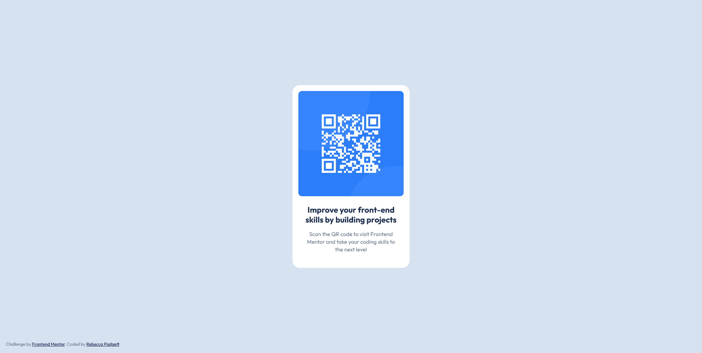

# Frontend Mentor - QR code component

This is a solution to the [QR code component challenge on Frontend Mentor](https://www.frontendmentor.io/challenges/qr-code-component-iux_sIO_H). Frontend Mentor challenges help you improve your coding skills by building realistic projects.

## Overview
A simple, responsive QR code component built with HTML and CSS. The design encourages good practices in layout, typography, spacing, and responsiveness.

## Screenshot

## Demo

- Solution URL: [Frontend Mentor]()
- Live Site URL: [GitHub Pages]()

## Tech Stack

- HTML
- CSS
  - CSS Grid
  - Flexbox

## What I Learned

- Replacing generic color shade names (e.g., slate-300) with meaningful, semantic CSS custom properties (e.g., --clr-bkg) to improve readability and maintainability.
- Creating CSS variables for spacing and borders is very helpful when you want change something at a later date.

## Author
- Frontend Mentor - [@rebeccadoesweb](https://www.frontendmentor.io/profile/rebeccadoesweb)
- GitHub - [@rebeccadoesweb](https://github.com/rebeccadoesweb)
- LinkedIn - [@rebecca-web-dev](https://www.linkedin.com/in/rebecca-web-dev/)

## Acknowledgments
- Readme.so - [Readme.so](https://readme.so/) - I used Readme.so to generate this README.md file.
- Google Font Helper - [Google Fonts Helper](https://gwfh.mranftl.com/fonts) - I used free Google Font Helper to generate the font imports.